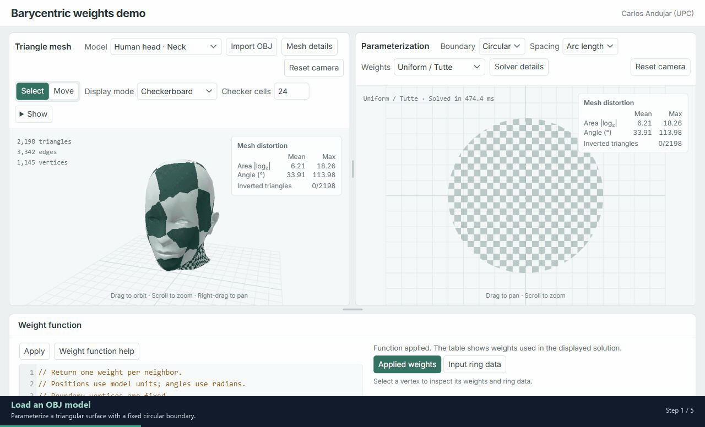

# Barycentric weights demo

An interactive app for exploring how barycentric weights and other aspects affect the parameterization of a triangle mesh. The author uses it in a geometry processing course to explain barycentric weights in planar mesh parameterization.

The app shows side-by-side a **Triangle mesh** view and a **Parameterization** view. Its main purpose is to allow users to see the effect on the final parameterization of key choices: 

- the shape of the boundary (circular or square), 
- the method to map boundary vertices to the boundary shape (uniform spacing or arc-length), and
- the method to compute barycentric weights (Uniform / Tutte, Mean Value, Cotangent / Harmonic, or Inverse Distance).

Users can experiment with different options for the choices above, and visualize distortion in multiple ways. Users can also edit the code of the weight function and see how it affects the parameterization.

The app allows users to load some predefined meshes (as well as their own OBJ files) and move vertices to see how the parameterization changes. 

## Using the app

To run the app on your computer, follow the [local setup instructions](docs/TECHNICAL.md#run-locally). Serve it over HTTP; opening `index.html` directly does not work.

1. Choose a **Model**, or use **Import OBJ** to open your own mesh. Polygonal faces are triangulated automatically. Parameterization requires a connected surface with disk topology: one boundary loop and no holes or handles. **Mesh details** explains preparation issues. Imported files stay in your browser.
2. Try a **Circular** or **Square** boundary and change **Spacing**. Choose **Weights**: Uniform / Tutte, Mean Value, Cotangent / Harmonic, or Inverse Distance. The result updates automatically.
3. Use **Display mode** to map onto both the mesh and its parameterization: a checkerboard, a UV grid, or other distortion visualizations like angle distortion, area distortion, or inverted triangles. 
4. Click a vertex or triangle to **select** it in both views. Selected triangles show their local distortion. 
5. Select a vertex and activate **Move** to drag it in the 3D view; the parameterization updates on release. Click outside the mesh to deselect.
6. Explore the **Weight function** code editor to see and edit the selected method's code. Press **Apply** or **Ctrl+Enter** to try your changes. Select a vertex to inspect its weights and its **Input ring data**. **Weight function help** explains the ring data available to the function. 

## More details

See [Weight function help](docs/WEIGHT_FUNCTION.md) for the illustrated guide to writing your own weights. Disclaimer: LLM generated, with limited revision. 

See [Technical and implementation details](docs/TECHNICAL.md) for the weight-function contract, distortion definitions, solver, tests, and GitHub Pages deployment. Disclaimer: LLM generated, with limited revision. 

## Credits and AI-Assisted Development

The original concept, user interface design, software architecture, and specification of the application's core functionality were conceived and defined by **C. Andújar**.

**AI implementation disclaimer:** The entire software implementation was carried out using AI-assisted code generation, specifically **OpenAI Codex with the GPT-6.1+Sol model**. Nearly all source code was generated by the LLM based on the original design, specifications, and iterative guidance provided by the author.

**Acknowledgements**: 
Anatomical examples are based on MakeHuman assets released under CC0; see [model credits](docs/MODELS.md).

## License

The application code and associated documentation are released under the [MIT License](LICENSE).

The MakeHuman-derived anatomical models retain their [CC0 license and credits](docs/MODELS.md#source-and-license). Third-party libraries retain their respective licenses.

