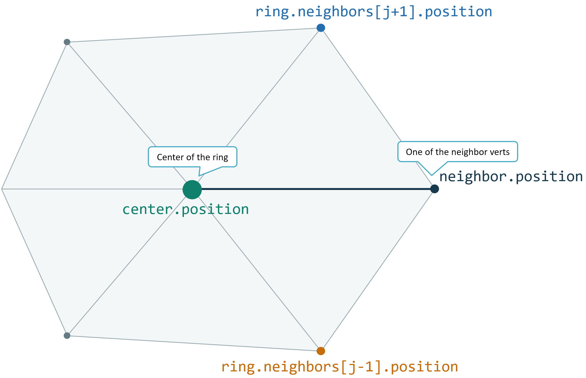
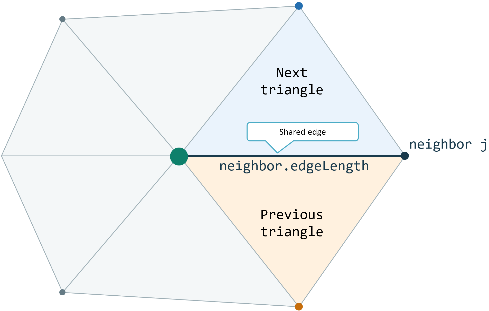
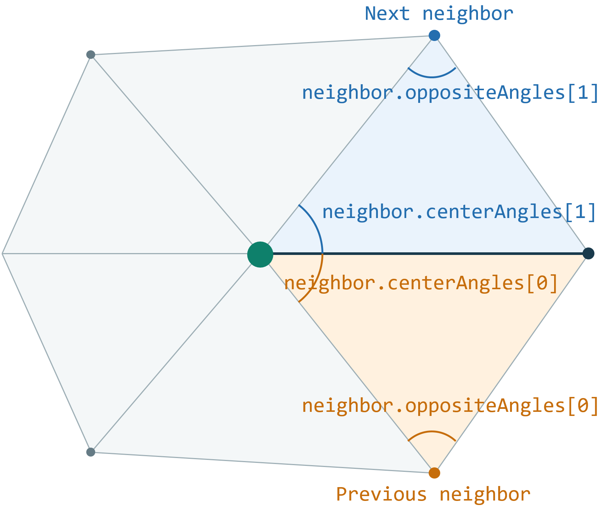

# Weight function help

## `computeWeights(ring)`

The solver calls this synchronous JavaScript function once per interior vertex. Return one unnormalized weight per neighbor, in the same order as `ring.neighbors`.

```javascript
function computeWeights(ring) {
  return ring.neighbors.map(neighbor =>
    1 / neighbor.edgeLength
  );
}
```

This example reproduces Inverse Distance weights. Positions use original model units; angles are unsigned and measured in radians in each 3D triangle.

## The ring object

| Field | Description |
| --- | --- |
| `ring.center` | `{ id, position }`. The current center's zero-based vertex ID and `[x, y, z]` position. |
| `ring.isBoundary` | A boolean indicating an open boundary fan. Boundary vertices can be inspected in **Input ring data**, but the solver fixes their UVs and does not evaluate their weights. |
| `ring.neighbors` | Neighbors in oriented face-fan order, not sorted by ID or distance. An interior ring wraps around; a boundary fan is open. |
| `ring.faces` | The incident triangles, described below. Associate them with neighbors by face ID; their array order need not match neighbor order. |



*Fig 1. One-ring of a vertex: position of the center and some of its neighbors.*

## Each neighbor

For `neighbor = ring.neighbors[k]`, side **[0]** is the previous face and side **[1]** is the next face in fan order.



*Fig 2. One neighbor vertex, the shared edge, and the two triangles sharing the edge.*

| Field | Description |
| --- | --- |
| `neighbor.id` | The neighbor's zero-based vertex ID. |
| `neighbor.position` | The neighbor's original `[x, y, z]` position. |
| `neighbor.edgeLength` | The Euclidean distance between `center.position` and `neighbor.position`. |
| `neighbor.centerAngles` | `[previous, next]`: angles at the center, between the selected edge and the edge to the previous or next neighbor. Mean Value weights use these angles. |
| `neighbor.oppositeAngles` | `[previous, next]`: angles opposite the selected edge, located at the previous and next neighbors, not at the selected neighbor. Cotangent weights use these angles. |
| `neighbor.oppositeVertexIds` | IDs of those previous and next vertices, in the same two-side order. |
| `neighbor.incidentFaceIds` | IDs of the previous and next triangles sharing the selected edge. |



*Fig 3. Angles around the center vertex (`centerAngles`) and angles opposite to the shared edge (`oppositeAngles`) for a given neighbor.*

On an open boundary fan, a missing side is `null` in each angle/ID pair. The illustrations are planar; the same definitions apply locally to curved meshes.

## Each incident face

| Field | Description |
| --- | --- |
| `face.id` | The zero-based triangle ID, after any OBJ triangulation. |
| `face.vertexIds` | The triangle's three vertex IDs in face-winding order. |
| `face.positions` | Three `[x, y, z]` positions in that same order. |
| `face.area` | Triangle area in squared model units. |
| `face.normal` | A unit `[nx, ny, nz]` normal oriented by the face winding. |

## Return rules

- Return an ordinary array with exactly `ring.neighbors.length` entries. Entry `k` weights `ring.neighbors[k]`.
- Each entry must be a finite number. Negative and zero weights are allowed; `NaN`, infinities, Promises, and typed arrays are rejected.
- The row cannot be all zero or have a numerically canceling sum. You do not need to normalize the weights; the solver handles this.
- Inputs are copied and read-only. Do not modify the ring, its objects, or its arrays.

The interior equation is:

```text
UV_i = sum(w_ij * UV_j) / sum(w_ij)
```

Weights do not have to be symmetric across an edge.

## Evaluation and updates

The function runs in isolation without DOM or network access.

Click **Apply** to evaluate your custom function. Moving a vertex reevaluates the function; changing only **Boundary** or **Spacing** reuses its evaluated weights. If evaluation or solving fails, the last valid UV solution is kept.

**Input ring data** shows the values for the selected vertex. **Applied weights** shows raw and normalized weights used in the displayed solution.
